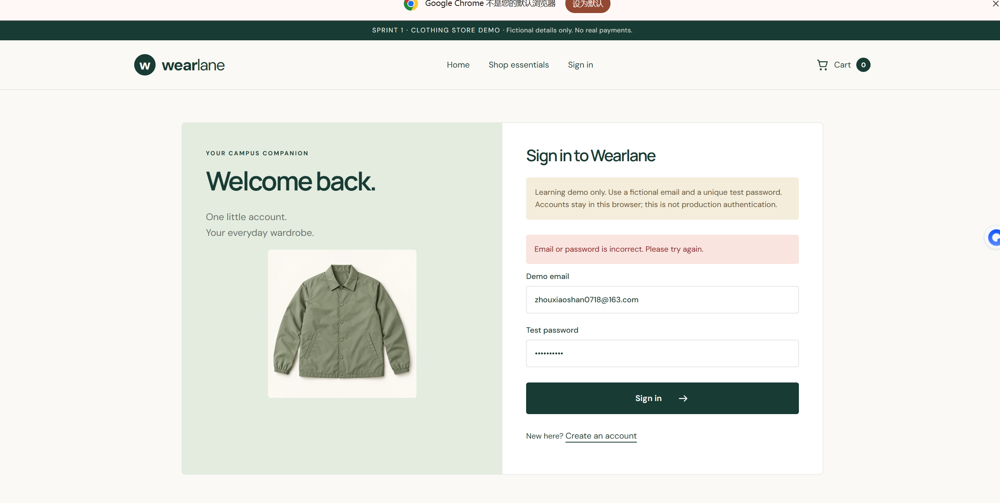
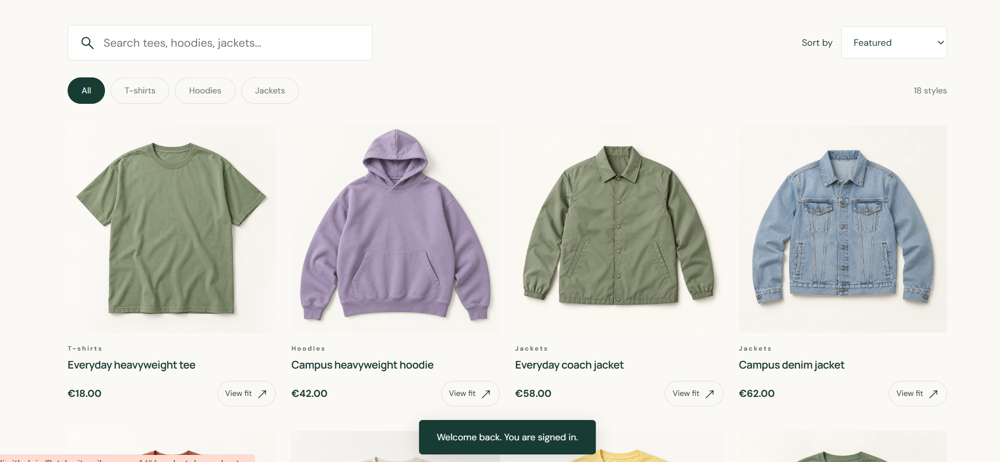
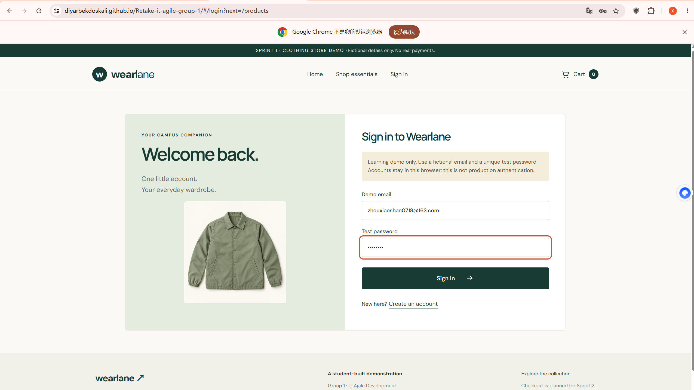
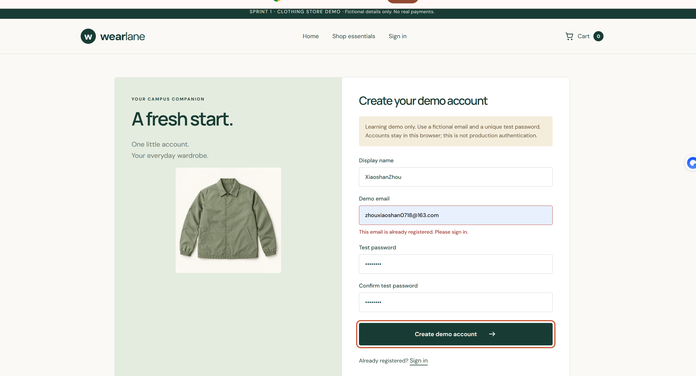
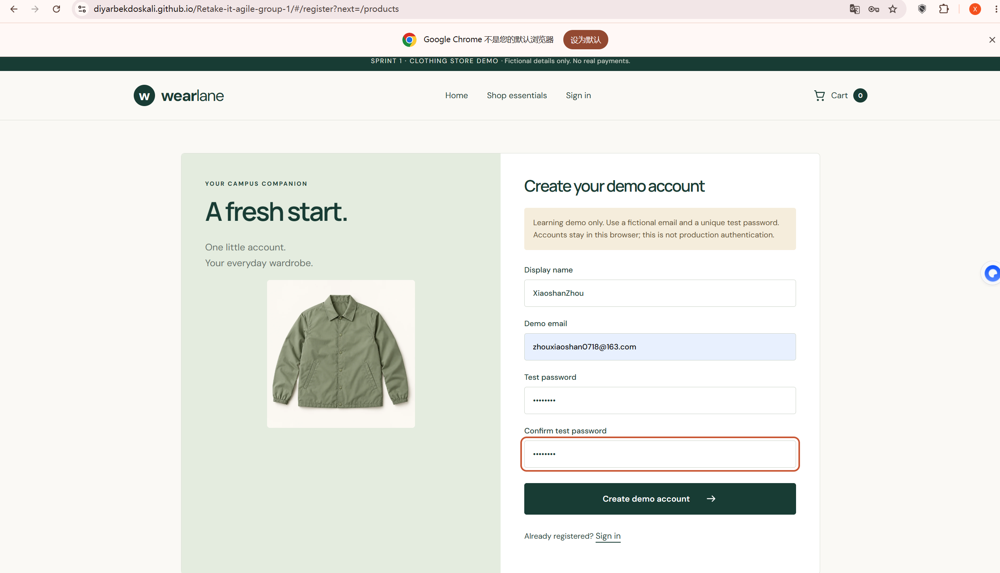

# Wearlane — Registration, Login & Logout Test Results
Site: https://diyarbekdoskali.github.io/Retake-it-agile-group-1/

## Summary
Scope: User registration, login, error handling and logout, related Jira responsibilities. All planned test cases passed, no defects observed.

## Test results
Tested by: Xiaoshan
Date: 2026-10-02
Device/browser: PC Chrome

Feature tested: User registration, login, error handling and logout

Steps performed:
1. Navigate to the website and open registration page
2. Complete registration with valid email and password
3. Attempt to register again using the same registered email
4. Navigate to login page
5. Log in with correct email and password
6. Attempt login with wrong password and non-existing email
7. Click logout button after successful login

Expected result:
1. Valid information: register successfully
2. Duplicate email: show prompt that the email is already registered
3. Correct credentials: login successfully and jump to the correct product page
4. Wrong email or password: pop up corresponding error message
5. Logout: user session ends, return to guest view

Actual result:
1. Registration works normally with valid information.
2. When re-registering with an existing email, the page pops up the reminder that this email has already been registered, and prevents duplicate registration.
3. Logging in with correct credentials successfully enters the product catalogue page, and "Welcome back. You are signed in." prompt appears.
4. Wrong email or password triggers clear red error reminder: "Email or password is incorrect. Please try again."
5. Logout function works properly and returns to guest view.

Result: Pass

Evidence:
- Wearlane_QA_Login_WrongCredential_Error.jpg.png
- Wearlane_QA_Product_List.jpg.png
- Wearlane_QA_Login_Page.jpg.png
- Wearlane_QA_Register_EmailExists.jpg.png
- Wearlane_QA_Register_Empty_Page.jpg.png

Remaining issues: None found

## Evidence review — 3 October 2026

Codex corrected the five image links to match the uploaded filenames. The tester/date/results above remain Xiaoshan's submitted record. [Jira CC-4](https://ue-germany-team-st01y82u.atlassian.net/browse/CC-4).

This report covers accounts, not Product Owner approval. Product Goal, priorities and explicit acceptance/remaining gaps still need a recorded PO/team decision. A blank registration screenshot does not itself demonstrate empty-form validation. Invalid registration inputs and refresh persistence require their own test results before claiming full coverage.

# Product Acceptance Test - CC-10
Tester: Xiaoshan Zhou
Date: 18 Oct 2026
Browser: Google Chrome
Test account: xiaoshan.test@demo.com

| Acceptance Criteria | Test Steps | Expected Result | Actual Result | Pass/Fail | Notes |
| ---- | ---- | ---- | ---- | ---- | ---- |
| 1. A signed-out visitor opening checkout is asked to sign in; no order can be placed while signed out. | Log out, add product to cart and click checkout. | Redirect to login page, unable to submit order. | After click checkout, redirected to login page, cannot access checkout without login. | Pass | |
| 2. Sign-in and registration return to the intended internal checkout route, preserving cart items and sizes. | Add product to cart, go to checkout, then log in. | After login, return to checkout page, cart items remain. | Login succeeded, redirected back to checkout, cart items and sizes kept. | Pass | |
| 3. The session is checked again at order placement; signing out in another tab prevents a stale session from completing an order. | Tab A stays at checkout page, log out account in Tab B, go back to Tab A and try to submit the order. | Order submission blocked, session invalid, cannot finish order. | After logging out in Tab B, Tab A can still submit the order successfully. The session does not get re-validated on order placement. | Fail | Defect found: Session recheck missing on order submission. User can still place order with stale session. This is a blocking issue. |
| 4. Check that the confirmation view belongs to the current demo account. Document that local browser storage is not production-grade authentication or security. | Complete checkout until confirmation page. | Confirm page shows current test user. Local storage only for demo, not production security. | Confirmation page displays current demo account. Local browser storage only for demo purpose, not production-ready security. | Pass | Demo security note: Local browser storage used for demo only. Not production ready. |
| 5. Personally review the Sprint 2 acceptance criteria and record accepted / not accepted, reasons, and remaining priorities. | Review all criteria above. | Record all pass/fail status. | Reviewed all 6 criteria, recorded pass/fail results. | Pass | Remaining priority: Fix AC3 session validation defect. |
| 6. Add evidence for your checks and prepare your own Product Owner presentation segment. | Capture screenshots and prepare presentation video. | All screenshots saved, video script ready. | All screenshots captured, presentation script finished. | Pass | |

