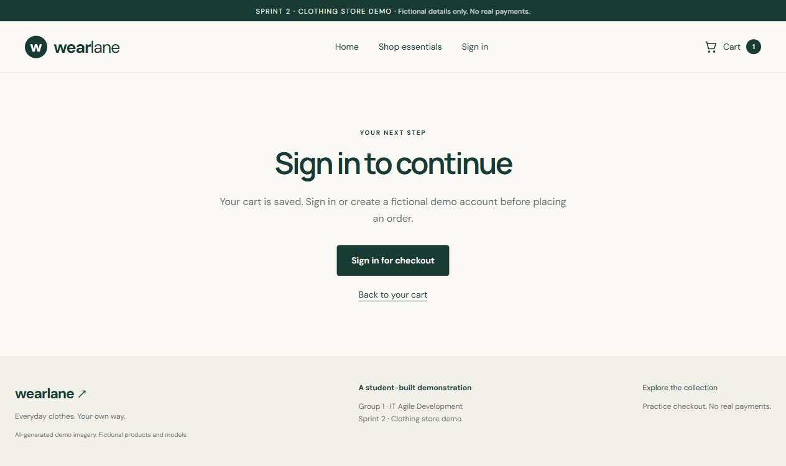

# WEARLANE — Sprint 3 cross-tab logout retest

**Result: Not reproduced under the conditions below.** The existing checkout review was replaced by the sign-in gate after logout in a second tab. Reloading remained blocked, and the cart contents were preserved. No application fix was made in this retest.

## Purpose and status

- Related report: [Xiaoshan's CC-10 acceptance test, AC3](REGISTRATION_LOGIN_TESTS_.md#product-acceptance-test---cc-10), dated 18 October 2026.
- Related Jira issue: [CC-10](https://ue-germany-team-st01y82u.atlassian.net/browse/CC-10).
- Execution: assisted browser verification on 30 October 2026. This is not a claim that Xiaoshan or another teammate personally repeated these steps.
- The original failed result remains unchanged. This retest does not establish the cause of the earlier failure, Product Owner acceptance, or completion of the full Sprint 3 regression plan.
- This report and its images are prepared locally. No Jira status, Confluence page, GitHub branch or deployment was changed by this work.

## Tested environment

| Item | Observed value |
| --- | --- |
| Site | https://diyarbekdoskali.github.io/Retake-it-agile-group-1/ |
| Checkout URL | https://diyarbekdoskali.github.io/Retake-it-agile-group-1/#/checkout |
| Browser | ChatGPT in-app browser on Windows; exact browser engine/version was not captured |
| Tabs | Two tabs in the same browser session, same HTTPS origin and project path |
| Viewport | 1280 × 720; no device override |
| Loaded JavaScript asset | `/Retake-it-agile-group-1/assets/index-BgmvsXNs.js` |
| Displayed release label | Sprint 2 |
| Local source baseline for code/test review | `b1162fe911299338f7787bef27916c7793190150` |
| Review evidence time | 30 October 2026, 14:52:04 CET (13:52:04 UTC) |
| Cross-tab logout observation | 30 October 2026, 14:52:08 CET (13:52:08 UTC) |

The deployed asset name was observed separately from the local Git revision; the browser test alone does not prove a deployment-to-commit mapping.

## Preconditions and fictional data

The browser initially showed a signed-out visitor and an empty cart. Through the website controls, the test added one **Everyday heavyweight tee**, size **M**, quantity **1**: subtotal **€18.00**, delivery **€2.90**, total **€20.90**.

A fictional, browser-local demo account was created: display name `Sprint Three Demo`, email `s3-session-20261030@example.test`. The unique test password is deliberately omitted from this report. Delivery values were `Demo Student`, `Example Street 12`, `Berlin`, `10115`, `Germany`; the fictional-details checkbox was checked. No real personal information or payment details were used.

## Steps and actual results

| Step | Action | Expected | Actual observation | Result |
| --- | --- | --- | --- | --- |
| 1 | Open checkout with the cart while signed out. | Authentication is required. | “Sign in to continue” appeared with a sign-in-for-checkout link. | Pass |
| 2 | Follow the checkout sign-in route, create the fictional account, and return. | Checkout opens and preserves the cart. | Checkout showed the demo account, tee size M, quantity 1 and total €20.90. | Pass |
| 3 | Fill the valid fictional delivery form and choose Review demo order. | A valid review is available before logout. | “Review your demo order” and enabled “Place demo order · €20.90” appeared; successful simulated payment was selected. | Pass |
| 4 | Open the same site in Tab B. | The second tab shares the signed-in session. | Tab B displayed the Sign out button and a cart count of 1. | Pass |
| 5 | Click Sign out in Tab B, then inspect Tab A without reloading. | Stale checkout cannot be submitted. | Tab A changed to “Sign in to continue.” The order-placement button count was 0. No order submission or confirmation occurred. | Pass in this run; reported failure not reproduced |
| 6 | Reload Tab A at the checkout URL. | The sign-in gate remains. | “Sign in to continue” remained visible. | Pass |
| 7 | Follow Back to your cart. | Logout has not lost the cart. | The same tee, size M, quantity 1, €18.00 subtotal, €2.90 delivery and €20.90 total remained. | Pass |
| 8 | Remove the test-added tee through the cart control. | Restore the starting cart/session state. | Empty cart and signed-out navigation were visible. | Cleanup complete |

At step 5, the submit control had already disappeared, so there was no stale visible button left to click. The browser test did not bypass the UI, inspect stored order records, or simulate a precisely timed simultaneous logout/submit race. It establishes the observed normal two-tab flow, not every possible timing or browser condition.

## Supporting code and automated checks

The local source already contains two checks of the persisted session: [beginCheckout](../src/checkout.js) and `placeDemoOrder` both reject a missing or changed customer with `AUTH`. [The application](../src/main.jsx) also listens for storage changes and updates the signed-in UI across tabs.

The existing checkout test file was run on 30 October using:

```text
node --test tests/checkout.test.js
44 tests; 44 passed; 0 failed; 0 skipped
```

Relevant existing assertions include:

- Signed-out checkout throws `AUTH` and leaves order history absent in the isolated test fixture.
- An unknown session and a changed customer are rejected.
- A signed-out customer cannot read a saved confirmation through the application helper.

These are automated checks using an in-memory storage fixture, separate from the live browser observations. They do not prove that the earlier browser failure was mistaken. No new test cases or application code were added in this step.

## Evidence

1. [Valid review before logout](sprint-3-session-evidence/01-review-before-logout.png).
2. [Tab A blocked after logout in Tab B](sprint-3-session-evidence/02-checkout-blocked-after-other-tab-logout.png).
3. [Cart contents preserved](sprint-3-session-evidence/03-cart-preserved-after-logout.png).
4. [Signed-out empty cart restored](sprint-3-session-evidence/04-test-cart-restored.png).



No captured warning/error entries were returned from Tab A's available browser log at the end of this run. That log check is limited to this captured tab session.

## Remaining work and limits

- Ask Xiaoshan to confirm the exact URLs in both original tabs, browser/profile/private-window setup, and the last screen before logout and after submission. If reproducible, record the deployed asset and exact sequence, then fix and retest that scenario.
- Keep the reported issue in investigation until the discrepancy and acceptance are resolved. A matching successful retest can be added by the Product Owner; this report must not replace their personal acceptance.
- Confirmation visibility after a real demo order, cross-tab account switching, mobile browsers and the full shopping flow were not rerun in this focused browser session. Existing automated confirmation checks passed; broader live regression remains separate work.
- Cart singular wording still reads “1 items” and is a separate small usability issue.
- The original signed-out/empty-cart state was restored. The fictional demo account remains in this browser's local storage; no existing accounts or orders were deleted. Temporary test tabs were closed.
